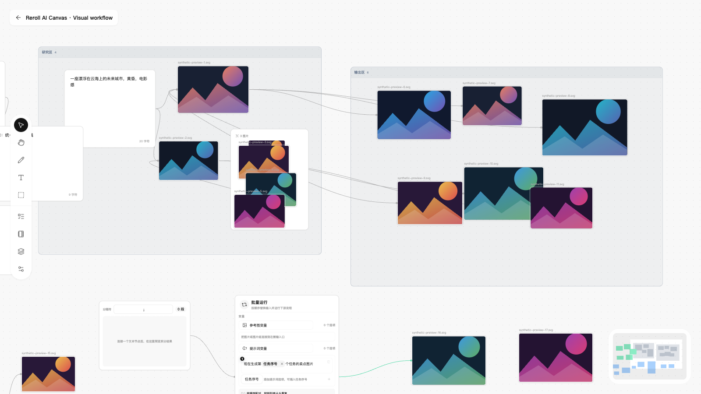

<h1 align="center">
   Reroll AI Canvas
</h1>

<p align="center">
  <strong>An AI infinite canvas that runs on your own computer, made for small teams creating images and video together.</strong><br />
  Prompts, references, generation steps and results all live on one shared canvas, so everyone is in the room and every change is in plain sight.
</p>

<p align="center">
  <a href="README.md">简体中文</a> · <b>English</b>
</p>

<p align="center">
  <a href="https://github.com/lazyq666/reroll-ai-canvas/actions/workflows/public-readiness.yml"></a>
  
  
</p>

<p align="center">
  <a href="#features">Features</a> ·
  <a href="#quick-start">Quick start</a> ·
  <a href="#documentation-map">Documentation</a> ·
  <a href="#original-project-and-author">Original project</a> ·
  <a href="#license">License</a>
</p>

<p align="center">
  
</p>

> [!NOTE]
> Reroll AI Canvas is source-available under a license with non-commercial restrictions. It is not open source as defined by the OSI. Please read the [LICENSE](LICENSE) before you use, redistribute or build on it.

> [!IMPORTANT]
> Reroll is built on [hero8152/Infinite-Canvas](https://github.com/hero8152/Infinite-Canvas). It is an independently maintained, unofficial derivative. The original author, project link, copyright notices and license terms are all kept intact.

> Most of the documentation linked below is written in Chinese.

## Features

<table>
<tr>
<td width="48%" valign="middle">

### Real-time collaboration

Open the same Smart Canvas and get to work together. You can see where everyone's pointer is, and selecting, dragging, zooming, panning and shortcuts all feel close to Figma. When someone edits a prompt, draws a connection or hits generate, everyone sees it right away.

Editing at the same time won't trip anyone up: the server keeps track of every revision, so concurrent changes are reconciled and mistakes can be recovered.

[Real-time collaboration →](docs/current/realtime-collaboration-performance.md)

</td>
<td width="52%">

https://github.com/user-attachments/assets/d3bb0d76-85bc-460c-b5a2-c11912522e57

</td>
</tr>
<tr>
<td width="48%" valign="middle">

### Accounts, roles & sharing

Permissions for a small team should be simple. Reroll has just three roles: Administrators run the workspace, Designers focus on creating, and Guest accounts can sign in to restricted pages but cannot open canvas editing or admin pages. New teammates request an account on the sign-in page; once an Administrator approves it, they get access project by project. Canvases can be private or shared.

Need a client to review something? Send a read-only link. They don't need to sign up, and you can revoke the link with one click when the project wraps. Permissions apply all the way through page access, canvas editing and generation tasks.

[Roles and permissions →](docs/PROJECT-MAP.md#用户和权限)

</td>
<td width="52%">

https://github.com/user-attachments/assets/8035eb0e-05ef-4996-8d34-3780d51d552c

</td>
</tr>
<tr>
<td width="48%" valign="middle">

### Built-in creative tools

Stop exporting and re-importing for everyday edits. Right from an image node you can use smart layers, angle control, background removal, lighting reference, depth maps and image to prompt.

Results stay on the canvas, connected to the original, ready to link up, compare and reuse.

[Generation pipeline →](docs/current/generation-pipeline.md)

</td>
<td width="52%">

https://github.com/user-attachments/assets/89c20860-08b5-4769-8cee-7f4639d38e58

</td>
</tr>
<tr>
<td width="48%" valign="middle">

### Prompt templates & asset library

Prompts that work and assets you love deserve another run. Keep them in your workspace's template and asset libraries, then search, preview and drop them straight back onto the canvas. No more digging through chat history or shuttling files between apps.

[Workspace asset library →](docs/current/workspace-asset-library.md)

</td>
<td width="52%">

https://github.com/user-attachments/assets/0fcb8b20-a045-40c7-85bb-1cc4bffe9997

</td>
</tr>
<tr>
<td width="48%" valign="middle">

### LAN deployment, local first

Reroll runs on your own computer. Canvases, media files and generation history are stored in a workspace folder you choose, and teammates on the same trusted network join from their browser.

When you use an online model, generation requests are sent to the AI provider you configured.

[Local and LAN access →](docs/current/local-network-access.md)

</td>
<td width="52%">

https://github.com/user-attachments/assets/0627e45c-3178-462f-a17d-a90a3969985f

</td>
</tr>
<tr>
<td width="48%" valign="middle">

### Batch generation

Want to try several prompts across several models in one go? Plan the whole batch in a dedicated workbench, review every task before you submit, then follow the queue, progress and results gallery in one place.

On the canvas, a Batch run node can also swap variables in order and run the neighboring generation steps one after another.

[Batch run node →](docs/current/smart-canvas-batch-run-node.md)

</td>
<td width="52%">

https://github.com/user-attachments/assets/384dafd2-91be-4a68-8330-ff1f91e98861

</td>
</tr>
</table>

<sub>These clips combine real screen recordings with motion graphics; the background-removal comparison and the LAN segment are illustrative animations.</sub>

**And there's more:** Frames and Smart Groups to organize the canvas; image, video, audio and text nodes; readable connections; full generation history; model and API management; compatibility with ComfyUI, RunningHub, ModelScope and CLI tools; and encrypted configuration backups you can take with you.

---

## Quick start

You don't need to install Python first. The launcher sets up a dedicated Python 3.12 environment for Reroll when needed, creates a virtual environment and installs pinned dependencies. Your system Python is left alone.

### 1. Start Reroll

| Platform | Launcher |
| --- | --- |
| Windows 10/11 | Double-click `启动服务-Windows.bat` (Start Reroll for Windows) |
| macOS | The first time, right-click `启动服务-macOS.command` and choose Open; after that, just double-click it (Start Reroll for macOS) |
| Linux / terminal | Run `bash 启动服务-macOS.command` |

Once it's up, open `http://127.0.0.1:3000/` in your browser. If port 3000 is taken, the launcher automatically tries 3001, 3002 and so on.

> The first launch needs an internet connection to download the runtime and dependencies. Whether generation needs one later depends on whether you use online APIs or a local ComfyUI.

### 2. Create an administrator and connect AI services

The first time you open Reroll, it walks you through a few steps: create the local Administrator, choose where your work is saved, then pick the AI services you want and connect them one by one. As soon as one service passes its connection and model checks, click **Start creating** to reach your canvases; you can add more services later in **API settings**. Existing installations are not asked to repeat this setup.

From then on, other people can request a Designer account on the sign-in page. An Administrator reviews requests in **Account management** and assigns the projects each Designer can open. Guest accounts can't open canvas editing or admin pages.

### 3. Create a canvas

Pick a workspace and create a Smart Canvas inside a project. Drag in your references, add a Prompt or Generation Node, and use connections to tie inputs, references and results together.

To use a local ComfyUI H3: an Administrator first sets up the instance in **Workflow settings** and imports a compatible API workflow; it then appears by name in the video model menu. The machine running Reroll must be able to reach that instance and needs `ffprobe` on its `PATH` (usually included with FFmpeg) to check reference video and audio before submitting. Supported templates, parameters and verification scope are covered in the [H3 workflow notes](docs/current/comfyui-h3-workflows.md).

### Let an external agent arrange your canvas

Want Codex, the Claude desktop app or Claude Code to lay out and batch-build canvases for you? It takes three steps:

1. On the computer that runs the agent, open Reroll, go to **App connections** in the account menu, choose the app and your system, then click **Download installer**.
2. Unzip it, quit the app you chose, then double-click `Install.command` (macOS) or `Install.cmd` (Windows). The installer prepares its own runtime, backs up your existing configuration and sets up MCP for you.
3. Restart the app. The first time it calls Reroll, check the code shown in your browser and click **Yes, allow**. The connection then stays in place, with no configuration or tokens to type in.

Good to know:

- When installing on another device, open Reroll through the server's LAN address before downloading; `127.0.0.1` only ever means the current device.
- The first install needs an internet connection. The installer doesn't install Codex or Claude themselves, and your system may ask you to confirm opening the downloaded program.
- Agent access is off globally by default and has to be approved and turned on by an Administrator. Designers can use it once an Administrator has enabled access, and Administrators can shut off every connection from **App connections** at any time.
- The bridge runs on the agent's computer and reaches Reroll through the address your browser uses. It supports batch arrangement, referencing assets, pre-checks, safe undo and downloading results.
- Pairing grants both arrangement and `run` permission, which running tasks requires; keep the canvas page open under the same account while tasks run. The list of local folders it may read is empty by default.

For setup, environment variables and the workflow, see the [MCP bridge guide](tools/reroll-mcp/README.md); the verification scope is in the [agent MCP spec](docs/active/2026-10-17-agent-mcp-canvas-authoring-spec.md).

### Check the environment and repair dependencies

```bash
# Windows
启动服务-Windows.bat check
启动服务-Windows.bat install --force

# macOS / Linux
./启动服务-macOS.command check
./启动服务-macOS.command install --force
```

While the service runs, the launcher keeps watch over the backend. To stop it, press `Ctrl+C` in the original launcher window. Closing that window, the terminal tab or an outer launch task also works: the backend notices the watcher is gone and shuts down cleanly. Please don't start the backend directly, bypassing the launcher; controlled restarts such as switching workspaces would then have nothing to pick them up.

---

## Taking turns on two computers

If your local SQLite workspace lives in OneDrive and you switch between two computers, hand it over with **Storage location → Close workspace for handoff** rather than just switching machines.

- After the first successful handoff, the next launch asks for the handoff code from the previous computer. Before you start, wait until OneDrive has finished syncing on both sides.
- Simply closing the tab or terminal does not complete a handoff. After an unexpected exit, recover on the original computer.
- The recovery page lists the exact conflicting files. Once you've checked the code and the full data, you can explicitly keep the main record; Reroll backs it up first, then quarantines the extra record copies.
- If closing fails, the list shows canvas and node differences between database copies. Identical copies are selected by default; copies that differ are yours to check. After you confirm keeping the current file, Reroll backs it up, deletes the selected copies and retries the handoff. Database conflicts are never merged automatically.

This has been tested locally; real two-device acceptance is still in progress. See [workspace handoff](docs/active/2026-09-27-workspace-handoff.md).

You can also opt into [Turso online handoff](docs/active/2026-09-29-online-workspace-handoff.md): stop the server on one computer and the other verifies the handoff automatically when it starts, with no code to type.

- First upgrade and stop the service on both computers, then configure a private `handoff-service.json` in each computer's local Device State.
- On the original computer run `python scripts/configure_handoff.py --initialize`; on the second run `python scripts/configure_handoff.py`.
- Tokens never go into the repository or OneDrive, and your work is still saved locally.
- If the network fails, the original device hasn't handed off, or syncing is incomplete, Reroll refuses to open the workspace.

Online handoff has passed isolated testing against real Turso; real two-device OneDrive acceptance is still in progress. Configuration details and recovery limits are in the guide above.

---

## Documentation map

| What you want to know | Start here |
| --- | --- |
| The entry point for product, design and development docs | [Product knowledge base](docs/README.md) |
| Product scope, roles, tech stack and code ownership | [Project map](docs/PROJECT-MAP.md) |
| Shared product vocabulary | [Domain language](CONTEXT.md) |
| UI principles, component states and interaction acceptance | [UI design and interaction guide](docs/current/ui-design-guidelines.md) |
| Generation runs, provider adapters and result recovery | [Generation pipeline](docs/current/generation-pipeline.md) |
| Workspace, instance data, secrets and migration boundaries | [Storage layout and migration](docs/current/storage-layout-and-migration.md) |
| Accounts, LAN access and deployment notes | [Local and LAN access](docs/current/local-network-access.md) |
| Contributing code or docs | [Contributing guide](CONTRIBUTING.md) |
| Reporting a security issue privately | [Security policy](SECURITY.md) |

### Data and deployment boundaries

- The service listens on `0.0.0.0` by default so devices on the same trusted network can reach it. To allow only this computer, set `INFINITE_CANVAS_HOST=127.0.0.1` in the project's `.env` and restart.
- LAN access is not internet deployment. To expose Reroll publicly you need to set up your own HTTPS reverse proxy, secure cookies, trusted access boundaries and backups.
- Collaboration currently runs on a single Uvicorn worker; multiple workers, multiple instances and cross-server sync are not supported.
- Reroll is built for individual creators and small teams who trust each other. It is not a hardened multi-tenant internet SaaS.

---

## Contributing

Bug reports, feature requests, doc fixes and implementation ideas are all welcome:

- Search the [existing issues](https://github.com/lazyq666/reroll-ai-canvas/issues) first to avoid duplicates.
- For bugs, include steps to reproduce plus your OS and browser versions if you can. Keep API keys, cookies, private network addresses and local absolute paths out of screenshots.
- Before writing code, please read the [contributing guide](CONTRIBUTING.md) and [AGENTS.md](AGENTS.md) in the repository root.
- After changing frontend assets, run `python3.12 scripts/sync_frontend_assets.py` and commit the generated reference updates. Upgraded pages pick up new code on a normal refresh while unchanged assets stay cached; rules and checks are in [frontend asset versions](docs/current/frontend-asset-versions.md).
- Any user-facing text in the product needs both Chinese and English, wired through the shared i18n resources.

---

## Original project and author

- Original project: [hero8152/Infinite-Canvas](https://github.com/hero8152/Infinite-Canvas)
- Original author on GitHub: [hero8152](https://github.com/hero8152)
- Original author on Bilibili: [78652351](https://space.bilibili.com/78652351)
- Original project video tutorial: [YouTube](https://youtu.be/r_y_9ALr7fg)
- Companion Chrome extension: [Chrome Web Store](https://chromewebstore.google.com/detail/ajfhnbklbmpfaaookhfakohabnpmlcic)

Thank you to the original author for publishing the complete project. The infinite canvas, model calls, asset management and creative tools at the heart of Reroll all build on it. If a problem only shows up in Reroll, please report it here first so the original author isn't left chasing issues unrelated to their code.

---

## License

This project follows the [LICENSE](LICENSE) in this repository and the original project's terms:

- You may not modify or repackage the project as a commercial product; commercial use requires appropriate authorization.
- Software built on this project must remain source-available and credit the original author.
- Derivative work must keep the original author `hero8152`, the original project link, and the source of the Reroll modifications.

This is a source-available license with non-commercial restrictions, not a standard OSI open-source license such as MIT or Apache-2.0. Third-party code, fonts, icons and service marks distributed with the repository remain under their own terms; see the [third-party notices](THIRD_PARTY_NOTICES.md). The [LICENSE](LICENSE) and statements from the original rights holder are authoritative; this summary is provided for convenience.
