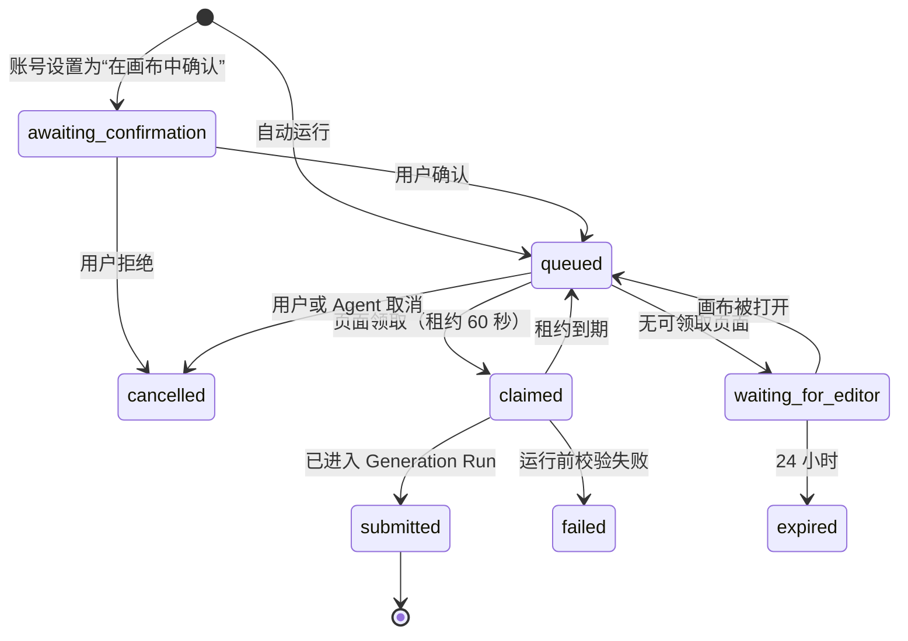

# Agent MCP：画布编排与批量生成

- **Status**：Implemented（待产品实机验收）
- **Feature ID**：F17（[项目地图](../PROJECT-MAP.md#功能规格注册表)）
- **Owners**：产品 / 交互 / 前端 / 后端 / 测试
- **Last verified**：2026-10-17（自动化、Chrome + 真实 Codex MCP 编排/运行/Provider 生成/下载通过；跨机器验收待完成；[LAZ-88](https://linear.app/lazyq/issue/LAZ-88)）
- **Applies to**：第一阶段（编排写入）与第二阶段（画布代为运行）；第三阶段（无浏览器提交）另立规格
- **Supersedes**：无
- **Superseded by**：无
- **P0 节点修改扩展**：[完整读取、图片预览与安全修改合同](../current/agent-task-editing.md)（LAZ-89，2026-10-22；该接口范围已通过隔离 stdio MCP 验收，不改变本规格其余实机 gate）
- **Related ADRs**：[ADR-0001 Workspace 数据边界](../adr/0001-workspace-data-boundary.md)、[ADR-0008 默认允许局域网访问](../adr/0008-lan-access-by-default.md)、[ADR-0009 统一模型能力目录](../adr/0009-unified-model-capability-catalog.md)、[ADR-0011 位置意图属于 Canvas Mutation](../adr/0011-placement-intent-belongs-to-canvas-mutation.md)、[ADR-0016 Canvas 媒体名称分配](../adr/0016-canvas-media-name-allocation.md)、[ADR-0019 Account Agent 编排](../adr/0019-account-agent-canvas-authoring.md)
- **Domain terms**：Smart Canvas、Node、Image Node、Prompt Node、Frame、Connection、Canvas Mutation、Operation ID、Canvas Revision、Canvas Selection、Canvas Viewport、Realtime Presence、Reference Input Instance、Prompt Authoring、Generation Settings、Generation Run、Pending Node、Model Capability Catalog、Managed Media、Workspace Asset Library、Account、Designer、Administrator、Guest Account；新增术语见第 8 节与 CONTEXT.md

## 1. 一页摘要

设计师通常先用外部 LLM 或 Agent（Claude Code、Codex 等）批量编写、发散提示词，再手动复制进画布，并逐个连接参考图、视频和音频。生成视频时，每个任务往往有多份参考素材，同时提交多个任务时，复制、找素材、连线、配参数要重复很多遍。

本功能提供一个 MCP（Model Context Protocol）服务，让 Agent 直接操作 Reroll 画布：

- Agent 用 `@标签` 在提示词里引用素材。素材可以是画布上已有的节点、当前选中的内容、资产库条目，或 Agent 所在电脑上的本地文件。
- 素材缺失时，Agent 在用户允许的本地文件夹里查找，并自动导入画布。
- 一次调用可以批量创建多个生成任务。每个任务是一个已配置好模型、参数、提示词 @ 标记和输入连线的生成节点，统一整理在一个分区里。
- 默认写入用户当前正在看的画布，不需要复制画布 ID 或输入画布名称。
- 第二阶段起，Agent 可以请求运行这些任务。实际执行由用户已打开的画布页面完成，与手动点击“运行”完全一致。

最重要的边界：

- Agent 以某个 Account 的身份操作，权限与该账号在网页中完全相同。
- 只要网页能打开画布，局域网内其他电脑也能使用。
- 所有写入都经过现有 Canvas Sync，实时出现在打开的画布上，并可以撤销。
- 第一阶段不会产生任何生成费用。

## 2. Problem Statement

- 提示词由 LLM 产出后，需要逐条复制到画布，批量任务时非常低效。
- 视频任务需要多张图片、视频、音频参考。用户必须先找到文件、导入画布、逐条连线，再在提示词中逐个 @ 引用，容易漏连、错连。
- 同时制作多个任务时，模型、时长、画幅等参数要在每个节点上重复设置。
- 外部 Agent 无法知道画布上有哪些素材、模型能接受多少参考输入，写出的提示词经常不符合模型限制，要到运行时才报错。

## 3. Goals / Non-goals

### Goals

1. Agent 能在一次调用中，在当前画布上创建 1–50 个生成任务，每个任务的提示词 @ 标记、输入连线、模型和参数都正确，打开 Composer 时与手动创建的结果没有区别。
2. Agent 能用名称、选中顺序、资产库查询或本地路径引用素材。无法唯一确定时，返回候选让 Agent 追问，而不是猜。
3. Agent 能在用户允许的本地文件夹里查找缺失素材并导入，导入后的素材成为 Managed Media，并出现在画布上。
4. 写入前用 Model Capability Catalog 预检引用数量、类型组合和参数范围，不合格时整批拒绝，并返回可修正的原因。
5. 默认目标画布为用户当前正在看的画布，同一 Agent 会话在批量过程中不会写到其他画布。
6. 局域网内其他电脑上的设计师，用自己的账号也能完整使用。
7. 第二阶段：Agent 能请求运行任务，并查询状态、下载结果；执行逻辑与手动点击“运行”完全相同。
8. 每次 Agent 写入都能整体撤销。

### Non-goals

- 第三阶段的“无浏览器提交”（服务端独立整理提示词并调用 Provider）不在本规格内，另立规格。
- 不在 Reroll 内置 LLM，也不负责“生成提示词”本身；提示词由外部 Agent 产出。
- Agent 不能修改 Provider、Model、API Key、账号、Project、权限、Workspace 等管理设置。
- Agent 不能删除用户已有节点，只能撤销自己提交的写入（第 7 节 I 组）。
- 不适合直接暴露到公网；公网部署前提沿用 ADR-0008。
- 不新增 Generation Batch（批量生成工作台）记录，也不改变“批量运行节点”。
- 第一、二阶段不提供 HTTP 形式的远程 MCP，只提供本地 stdio 桥接进程。

## 4. Actors and permissions

| Actor | Preconditions | Can | Cannot |
| --- | --- | --- | --- |
| Designer | 账号状态有效；管理员已开启 Agent 访问；持有自己创建的 Agent 令牌 | 读取、写入自己有权编辑的 Canvas；导入素材；查询资产库与模型能力；第二阶段请求运行（令牌带运行权限时） | 访问无授权 Project 或他人私有 Canvas；修改管理设置；删除他人内容 |
| Administrator | 同上 | Designer 的全部能力；开关全局 Agent 访问；经兼容管理接口查看和撤销所有账号的 Agent 令牌 | 通过 Agent API 执行管理操作（管理仍只走网页） |
| Guest Account | — | 无 | 创建令牌、使用 Agent API |
| Anonymous Share Visitor | — | 无 | 使用 Agent API |
| Agent（外部） | 通过本地桥接进程持有某账号的令牌 | 以该账号身份执行令牌范围内的操作 | 超出该账号的权限；读取桥接进程允许目录之外的本地文件 |
| Local Operator | — | 与本功能无关；Agent API 不要求在服务机本机调用 | — |

权限以 Account 为准，与调用来自哪台电脑无关。仅限本机的工作区维护接口不对 Agent 开放。

## 5. User stories

1. As a Designer，我在 Agent 里写好 10 条视频分镜提示词后，让 Agent 一次提交到我正在看的画布，这样我不用逐条复制、连线和配参数。
2. As a Designer，我在画布上框选主角图、场景图和配乐，对 Agent 说“用选中的素材做 5 个变体”，Agent 能直接引用它们，不需要我命名或描述位置。
3. As a Designer，提示词引用的素材不在画布上时，Agent 能去我指定的文件夹里找到并导入，找不到或有歧义时告诉我候选。
4. As a Designer，我在另一台局域网电脑上，用自己的账号和令牌，也能做到上面所有事。
5. As a Designer，Agent 写入后，我在画布上收到提示，一键定位到新任务所在的分区。
6. As a Designer，Agent 写错时，我让它撤销刚才那次提交，画布恢复原状。
7. As a Designer，Agent 写入前就知道模型限制（例如全能参考最多几张图、音频是否可用），不会写出必然失败的任务。
8. As a Designer（第二阶段），我让 Agent 运行这 10 个任务，它们按并发上限在我打开的画布上依次开始，Agent 能告诉我进度并把结果下载到本地。
9. As a Designer，我同时开着两个画布时，Agent 写入的是我最近在看的那个；批量过程中切换标签页，后续任务不会跑到另一个画布上。
10. As an Administrator，我能关闭全局 Agent 访问，立即生效；兼容管理接口仍支持撤销某个成员的令牌。
11. 失败与恢复：网络中断后 Agent 重试同一次写入，不会产生重复节点；令牌被撤销后，后续调用明确返回未授权。

## 6. User journey and interaction contract

### Entry and exit

- **首次配置**：
  1. 在“Agent 访问”复制无令牌 MCP 配置到 Codex / Claude，指定允许读取的本地文件夹（默认空）。
  2. 首次工具调用发起 10 分钟有效的配对请求，返回地址、识别码和 `authorization_required`；原始操作不执行。
  3. 登录网页自动弹出同意／拒绝，展示自报客户端名、来源 IP、识别码、批准账号、编排与运行权限、长期有效且可撤销。用户核对识别码后同意，再次调用工具即可继续。
  4. 批准者账号拥有不过期凭证；桥接私有缓存自动保存并跨进程复用。全局关闭时仅管理员可批准并同时开启，弹窗明确提示。Designer 不可改变总开关。
  5. 连接弹窗不再显示手动令牌入口；后台兼容接口与既有 `REROLL_AGENT_TOKEN` 配置继续优先使用。
- **日常使用**：用户在浏览器中打开目标画布，在 Agent 中下达指令。
- **退出**：删除 Agent 客户端中的配置；管理员也可在“应用连接”关闭所有连接。逐个撤销只保留兼容管理接口。

### Happy path（第一阶段）

1. 用户打开画布《镜头分镜 v2》，框选 3 个素材。
2. 用户对 Agent 说：“用选中的素材，按这份分镜写 10 个视频任务，配乐用 refs 文件夹里的 bgm_tense”。
3. Agent 调用 `get_current_canvas`，确认目标画布名称；再调用 `get_selection`、`get_model_capability`。
4. Agent 先以 `dry_run` 调用 `create_generation_tasks`。服务端返回：2 个引用已解析、1 个未找到（`bgm_tense`）。
5. Agent 调用 `find_local_files`，在允许目录中找到 `bgm_tense.mp3`，把该引用改为本地文件后正式提交。
6. 服务端在用户当前视口附近创建分区“Agent · 镜头分镜”，内含 1 个新素材节点和 10 个生成节点，连线与 @ 标记就绪；画布实时显示，并弹出提示“Agent 新增了 10 个任务”，附“查看”按钮。
7. Agent 回复：“已写入画布《镜头分镜 v2》，10 个任务待运行。”
8. 用户逐个或多选运行；第二阶段可以让 Agent 调用 `run_tasks`。

### Observable states

Agent 生成任务（以生成节点为单位，状态从节点读取）：

| State | Trigger | User sees | Allowed actions | Exit condition |
| --- | --- | --- | --- | --- |
| draft | Agent 写入成功 | 已配置的空生成节点，Composer 中可见 @ 标记与参数 | 编辑、运行、删除、撤销本次提交 | 运行或被删除 |
| run_requested（第二阶段） | Agent 调用 `run_tasks` | 节点显示“等待运行”标记 | 取消请求 | 被页面领取，或过期 |
| waiting_for_editor（第二阶段） | 有运行请求，但该账号没有打开此画布 | 无（Agent 收到此状态） | 用户打开画布后自动领取 | 画布被打开，或请求过期（24 小时） |
| pending / running | 页面领取并提交 | 现有 Pending Node 表现 | 沿用现有行为 | 成功或失败 |
| succeeded | Generation Output 写回 | 现有输出表现 | 沿用现有行为 | — |
| failed | 运行前校验或 Provider 失败 | 现有失败反馈 | 修改后重试 | 重试 |

Agent 写入调用：

| State | Trigger | Agent receives | User sees |
| --- | --- | --- | --- |
| success | 整批写入成功 | 提交 ID、画布名称、各任务节点 ID | 新分区与提示 |
| needs_input | 有引用未解析或有歧义 | 未解析标签及候选列表；画布未改变 | 无 |
| rejected | 能力预检失败或参数非法 | 逐任务、逐字段的原因代码 | 无 |
| canvas_ambiguous | 无法确定目标画布 | 候选画布列表 | 无 |
| forbidden | 令牌无效、已撤销、全局关闭或无画布权限 | `unauthorized` / `forbidden` | 无 |
| conflict | 同一幂等键对应不同内容 | `operation_collision` | 无 |

### Input, pointer and keyboard

- 画布提示 Toast 中的“查看”按钮可通过键盘聚焦和触发，触发后把 Canvas Viewport 平移到新分区，不改变 Canvas Selection。
- 应用连接弹窗可用键盘选择应用、系统、下载安装包和修改偏好；不再提供令牌管理操作。
- 运行请求的“取消”入口（第二阶段）出现在节点悬浮菜单中，遵循现有菜单的键盘规则。

### Responsive and themes

- 应用连接弹窗与画布提示遵循现有桌面浏览器目标与 Light/Dark 主题，不新增移动端承诺。

### Copy and internationalization

- 产品界面中的全部新文案（设置页、Toast、节点状态标记、确认框、错误提示）必须进入共享 i18n 资源并同时提供中英文，按 AGENTS.md 完成 `node static/js/i18n/validate-i18n.js` 与语言切换检查。
- 关键文案示例（中文 / English）：
  - “Agent 访问” / “Agent access”
  - “创建令牌” / “Create token”
  - “令牌只显示一次，请立即复制” / “This token is shown only once. Copy it now.”
  - “Agent 新增了 {count} 个任务” / “Agent added {count} tasks”
  - “查看” / “View”
  - “等待运行” / “Waiting to run”
- Agent API 的响应和 MCP 工具描述面向程序，不显示在 Reroll 界面中，不属于 AGENTS.md 所指的产品文案：错误以稳定的 `code` 为准，附英文 `message`；MCP 工具描述只使用英文。这类文本不进入产品 i18n 资源，由 Agent 用用户的语言转述。

## 7. Functional rules

### A. 访问与认证

1. 全局开关“允许 Agent 访问”默认关闭，只有 Administrator 能修改。关闭后所有 Agent API 返回 `agent_access_disabled`，已签发的令牌保留但不可用。
2. 只有 Designer 和 Administrator 能批准配对或创建令牌，每账号最多 10 个有效令牌。网页配对固定授予 `authoring` 与 `run`、不过期；兼容管理接口保留仅编排和 30/90 天选项。
3. 常规配对令牌只在 Agent 本机生成、保存，不显示到网页；兼容管理接口只在创建时返回一次明文。服务端只保存哈希及审计元数据，连接弹窗不展示令牌列表。
4. 账号被停用、删除或降为 Guest Account 时，其令牌立即失效。用户可以撤销自己的令牌，Administrator 可以撤销任何令牌。撤销后的下一次请求即失败。
5. Agent 令牌只能访问 `/api/agent/v1/` 下的接口，不能访问其他产品接口，也不能当作登录 Session 使用。
6. 每次 Agent API 请求都重新检查账号状态、Role、Project Access Grant 和 Canvas Visibility，与网页请求的规则一致。
7. 请求来源不限于服务机本机。局域网访问遵循 ADR-0008。

### B. 目标画布

8. 所有画布类工具的 `canvas` 参数都是可选的。省略时，按以下顺序确定“Agent 目标画布”：
   1. 本次 Agent 会话已锁定的画布；
   2. 该账号最近聚焦且仍处于打开状态的 Smart Canvas。确定后由桥接进程锁定到本次会话；
   3. 两者都无法确定时返回 `canvas_ambiguous`，附带候选列表（当前打开的画布，以及最近编辑过的 5 个），不写入任何内容。
9. “最近聚焦”由画布页面上报：标签页可见且窗口获得焦点、或在画布上发生 Pointer 或键盘操作时更新。若 10 秒内有两个不同画布被聚焦，视为无法确定。
10. `use_canvas` 接受画布 ID 或名称，名称支持模糊匹配：唯一匹配时直接锁定；多个匹配时返回候选，不锁定。`create_canvas` 在用户有权创建的默认 Project 中新建画布，并锁定为目标。
11. 每个写入结果都返回画布 ID 与名称，供 Agent 告知用户。
12. 同一账号在多台电脑上同时打开画布时，以最近聚焦的那台为准。

### C. 读取画布

13. `get_canvas` 返回精简视图：节点 ID、角色（与现有节点角色定义一致）、名称、媒体类型与数量、提示词前 200 个字符、所属分区、生成状态，以及连线列表。
14. `get_canvas` 支持按角色、分区、名称关键词、仅选中等条件筛选，单页最多 200 个节点，并支持翻页。
15. `get_selection` 返回该账号在目标画布上当前选中的节点，按页面中的视觉顺序（与现有多输入的稳定视觉顺序一致）。若选中的是多媒体节点中的部分媒体，返回对应的媒体序号。选中状态只对同一账号可见。

### D. 引用解析

16. 生成配方中的 `refs` 是“标签 → 来源”的映射。标签由 Agent 自定义，长度 1–40 个字符，不能包含空白和 `@`。
17. 支持的来源：
    - `{"node": "<节点ID>"}`，可加 `"index"` 指定多媒体节点中的第几项；
    - `{"node_name": "<名称>"}`；
    - `{"selection": <序号, 从 1 开始>}`；
    - `{"asset": "<资产库条目 ID 或查询词>"}`；
    - `{"media": "<Managed Media ID>"}`；
    - `{"file": "<本地路径>"}`：仅由桥接进程处理，先上传再按 `media` 解析；
    - `{"search": "<关键词>"}`：依次在画布节点名称、画布媒体名称、资产库中查找。
18. 每个来源可以附加 `"kind"`（image / video / audio，用于校验），以及 `"role"`（`first_frame` / `last_frame`，用于首尾帧视频）。
19. 解析结果三选一：唯一匹配则采用；多个匹配返回 `ambiguous_reference` 及最多 10 个候选（含缩略图 URL、名称、来源位置）；无匹配返回 `missing_reference`。只要有一个引用未解析，整次调用不写入画布。
20. 提示词中只识别已在 `refs` 中声明的标签，按最长标签优先匹配（与现有的 `@名字` 还原规则一致）。中文文本无需空格分隔。未声明的 `@文本` 保持为普通文字，并在结果中以 `undeclared_mention` 警告列出。
21. 同一任务中，多个标签指向同一来源时，合并为一个输入（一条连线），这些标签都显示为指向它的 @ 标记，结果中以 `duplicate_reference` 警告列出。

### E. 本地查找与导入

22. `find_local_files` 只在桥接进程配置的允许目录内递归查找，不跟随指向允许目录之外的符号链接，忽略隐藏文件。每次最多返回 200 个结果。
23. 查找条件：文件名 glob、媒体类型（image / video / audio / text）、与给定标签或关键词的名称相似度；结果按相似度排序，并附带大小与修改时间。
24. `import_media` 通过 Agent API 上传，复用现有本地引用的格式白名单与单文件大小上限，结果是 Managed Media。上传按内容摘要去重：同一内容已存在于当前 Workspace 时复用已有媒体，不重复存储。
25. 导入素材的显示名称按现有媒体命名合同（ADR-0016）分配。

### F. 写入生成任务

26. `create_generation_tasks` 接受 1–50 个生成配方。一次调用对应一次 Canvas Mutation 和一个 Operation ID，全部成功或全部失败。
27. 每个配方字段：
    - `title`（节点名称，可选）；
    - `kind`（image / video）；
    - `model`（provider_id + model，可选，省略时使用画布当前默认生成设置）；
    - `params`（时长、画幅、分辨率、数量、是否生成音频等，键名以 `get_model_capability` 返回的为准）；
    - `refs`；
    - `prompt`。
28. 写入前，服务端用 Model Capability Catalog 校验每个任务：输入类型与数量、视频模式组合、首尾帧角色、参数范围、提示词长度。任一任务失败则整批返回 `rejected`，结果包含任务序号、字段、实际值和允许范围。
29. `dry_run: true` 执行全部解析与校验，返回解析报告和将要创建的节点数量，不写入画布、不上传文件。
30. 画布上的结果：
    - 每个任务成为一个生成节点（与 Quick Add 创建的空生成节点身份一致），设置好生成类型、生成设置、提示词草稿（含 @ 标记）和引用顺序。
    - 每个素材在画布上只对应一个节点，并由所有引用它的任务共享：已在画布上的素材保持原位；不在画布上的素材，在本次提交中每个不同媒体只创建一个 Image Node。
    - 素材一律以连线输入生成节点。提示词中的 @ 标记指向该来源节点（节点身份 + 媒体序号），不携带独立的手动引用身份。
    - 由此，替换素材节点中的媒体后，所有引用它的任务在下次运行时都使用新媒体，Composer 中的 @ 标记与参考缩略图也同步显示新媒体。
    - 例外：只引用多媒体节点中的部分媒体时，优先使用带指定输出的连线；无法用连线精确表达时，退回节点手动引用，并在结果中以 `snapshot_reference` 警告说明该引用不会随来源替换而变化。
31. 布局：
    - 每次提交新建一个分区，名称为“Agent · <提交标题>”。分区内左侧一列放新导入的素材节点，右侧按网格排列生成节点，间距沿用全局布局常量 G。
    - 分区落点优先选在用户最近上报的视口中心附近的空位；没有视口信息时，放在画布现有内容外框右侧 G 处。
    - 既有节点不移动；新分区与既有节点、编组不重叠。
32. 写入后，向该账号打开此画布的页面发送一条提示，含新增任务数和“查看”按钮。其他协作者只看到正常的画布变化。
33. Canvas Updated Time 与最近编辑人按现有规则更新，最近编辑人为令牌所属账号。

### G. 修改、运行与状态

34. `update_generation_task` 只能修改仍处于 draft 状态的生成节点的提示词、引用、模型和参数。规则同第 16–31 条，按字段提交；用户正在编辑同一字段时，沿用现有 Composer 冲突草稿规则。
35. `create_prompt_nodes` 批量创建普通 Prompt Node，用于保存发散方案，布局规则同第 31 条。
36. `get_task_status` 按节点 ID 或提交 ID 查询状态（第 6 节状态表）。生成成功时返回 Generation Output 的媒体 ID、类型、名称和下载地址。用户手动运行的任务同样可查。
37. `download_outputs` 由桥接进程把结果下载到本地目录，文件名沿用画布上的显示名称，重名时自动加序号。
38. **第二阶段**：`run_tasks` 要求令牌具有 `run` 权限。对每个 draft 节点创建一条“Agent 运行请求”：
    - 请求按账号排队，同时最多领取 N 条（默认 2，账号设置可改为 1–8）。
    - 该账号打开此画布的页面领取请求后，执行与手动点击“运行”完全相同的流程，包括全部前置校验、保存确认与失败反馈。
    - 同一请求只能被一个页面领取。领取有 60 秒租约，页面关闭或断线后租约到期，请求回到队列。
    - 没有可领取的页面时，状态为 `waiting_for_editor`；24 小时后过期为 `expired`。
    - 每次 `run_tasks` 最多 50 个节点。账号设置“Agent 运行确认”可选“自动运行”（默认）或“在画布中确认”；选后者时，页面先显示确认，用户同意后才开始领取。
    - 用户可以在节点菜单中取消尚未开始的运行请求。
39. 运行请求的结果与执行完全复用现有 Generation Run、Target Guard 和写回流程，不新增第二套任务状态。

### H. 幂等与重试

40. 每个写入类工具都需要幂等键。桥接进程为每次调用自动生成，网络重试时复用。服务端以“令牌 + 幂等键”生成 Operation ID：重复提交返回原结果，内容不同则返回 `operation_collision`。
41. 引用解析在服务端持有画布锁时完成，因此“检查”和“写入”之间画布被其他人改动不会导致写入到已删除的节点。

### I. 撤销

42. `undo_submission` 按提交 ID 撤销一次 Agent 写入，复用现有安全撤销规则。若后续修改与撤销冲突（例如他人已编辑这些节点），返回 `undo_conflict`，不做部分撤销。
43. 已经运行或正在运行的任务不能通过 `undo_submission` 撤销，返回 `undo_blocked_by_run`。

## 8. Domain and state model

拟新增到 `CONTEXT.md` 的术语（实施时写入，不写实现细节）：

- **Agent Token（Agent 令牌）**：代表一个 Account、带权限范围、可撤销的外部程序访问凭证。避免使用：API Key、Session、Share Link。
- **Generation Recipe（生成配方）**：外部 Agent 提交的、声明一个生成任务的提示词、引用、Model 与参数的结构；写入后成为生成节点的 Prompt Authoring 与 Generation Settings。避免使用：Workflow、Prompt Template、Generation Run。
- **Agent Submission（Agent 提交）**：一次写入调用，对应一个 Canvas Mutation 与 Operation ID，可整体撤销。避免使用：Generation Batch、Batch Generation。
- **Agent Target Canvas（Agent 目标画布）**：某个 Agent 会话当前写入的 Smart Canvas；由会话锁定或账号最近聚焦状态决定，是临时状态。避免使用：Current Workspace、Canvas Selection。
- **Editor Context（编辑端上下文）**：画布页面向服务端短暂上报的聚焦时间、Canvas Viewport 与 Canvas Selection，只对同一账号可读，不属于 Canvas 内容。避免使用：Realtime Presence、Canvas Mutation。
- **Agent Run Request（Agent 运行请求）**：Agent 请求运行某个生成节点、尚待画布页面领取执行的持久意图；它不是 Generation Run。避免使用：Generation Run、Queue Job。

Agent Run Request 生命周期：

`submitted` 之后的状态以节点上的 Generation Run 为准。

## 9. Data and persistence

| Data | Authority | Boundary | Retention | Migration/recovery |
| --- | --- | --- | --- | --- |
| Agent 全局开关 | Instance State | Instance | 长期 | 默认关闭；无迁移 |
| Agent Pairing（哈希、自报名称、识别码、来源、状态） | Instance State | Instance | 10 分钟，后续新请求清理 | 不随 Workspace 搬迁 |
| Agent Token（哈希、名称、范围、时间、最近使用） | Instance State | Instance | 撤销后保留审计记录 90 天 | 新表；不随 Workspace 搬迁 |
| 运行并发上限、运行确认方式 | Instance State（账号偏好） | Instance | 长期 | 缺省值即默认 |
| Editor Context | 服务进程内存 | 不持久化 | 连接断开或 60 秒无更新即清除 | 服务重启后由页面重新上报 |
| Agent 会话锁定的画布 | 桥接进程内存 | Agent 所在设备 | 进程生命周期 | 无 |
| Agent Submission 回执 | 现有 Canvas Mutation 回执 | Workspace Data | 沿用现有规则 | 沿用 |
| 生成节点、连线、分区、素材节点 | Smart Canvas | Workspace Data | 沿用 | 沿用 |
| 导入的素材 | Managed Media | Workspace Data | 被画布引用期间受现有清理保护 | 沿用 |
| Agent Run Request | Workspace SQLite authority | Workspace Data | 结束 7 天后清理 | 服务重启后恢复 queued / claimed（租约重新计时） |
| 桥接进程配置（服务地址、可选手动令牌、允许目录、下载目录） | Agent 所在电脑的环境变量或配置文件 | Device State（Agent 设备） | 由用户管理 | 无 |

令牌明文不写入日志、诊断信息或 Workspace。服务端诊断日志只记录令牌 ID。

## 10. API / WebSocket / Provider contracts

### Agent Pairing（网页批准）

- `POST /api/agent/pairing/start`：未登录桥接提交随机凭证 SHA-256 哈希和客户端名，幂等返回请求状态、识别码、到期时间；同一凭证不得重复签发。
- `POST /api/agent/pairing/status`：凭证持有人查看请求状态，无原始凭证回传。
- `GET /api/account/agent-pairings`、`POST /api/account/agent-pairings/{id}`：只走浏览器 Session；列出 Instance 待批准请求、原子批准/拒绝。跨站写入与 Bearer 均不能批准。
- 每请求 10 分钟；同时保留最多 32 个未过期请求、同 IP 最多 5 个（包括拒绝），正文最多 2 KiB。限流 `pairing_rate_limited`，稍后重试。
- 拒绝、Escape、关闭均不授予权限，同一请求在到期前保持拒绝。过期、重复审批返回 `pairing_closed`，多账号竞争只有第一次成功。
- 网页每 3 秒检查，隐藏标签不检查，其他弹窗关闭后再展示；应用连接窗口显示待授权提示与“查看请求”，点击后先关闭设置窗口，再显示独立配对窗口，不代为同意或拒绝。请求失效后提示移除。未登录时需先登录；未打开网页时 Agent 提示地址和识别码。
- 已授权凭证立即受撤销、账号停用、权限变更和总开关约束。缓存凭证撤销返回 `authorization_revoked`，再次调用发起新配对；总开关关闭不自行重新启用。
- 桥接缓存为 Agent 设备 Device State，按服务地址、客户端名隔离，默认 `~/.config/reroll/mcp/`，`REROLL_CREDENTIAL_DIR` 可覆盖；`REROLL_CLIENT_NAME` 可覆盖自报名字。私有原子写入，缓存无法读取时失败，不输出秘密。

### Agent API（`/api/agent/v1/`，Bearer 令牌）

| Contract | Caller | Observable result | Errors/recovery |
| --- | --- | --- | --- |
| `GET info` | 桥接进程 | 服务版本、Agent API 版本、令牌所属账号与权限范围 | `unauthorized`、`agent_access_disabled`、`api_version_unsupported` |
| `GET canvases` / `POST canvases` | 桥接进程 | 可编辑画布列表 / 新建画布 | `forbidden` |
| `GET context/target` | 桥接进程 | 推荐的目标画布，或候选列表 | `canvas_ambiguous` |
| `GET canvases/{id}` | 桥接进程 | 第 13–14 条的精简视图 | `forbidden`、`not_found` |
| `GET canvases/{id}/selection` | 桥接进程 | 第 15 条 | `no_editor_context` |
| `GET models`、`GET models/{provider}/{model}` | 桥接进程 | 能力目录中可用的 Model 与输入、参数边界 | — |
| `GET media/search` | 桥接进程 | 画布与资产库的候选媒体 | — |
| `POST media`（multipart） | 桥接进程 | Managed Media 身份 | 格式或大小超限 |
| `GET media/{id}/content` | 桥接进程 | 媒体内容，用于下载结果 | `forbidden` |
| `POST canvases/{id}/submissions` | 桥接进程 | 第 26–33 条；支持 `dry_run` | `needs_input`、`rejected`、`operation_collision`、`placement_failed` |
| `PATCH canvases/{id}/tasks/{node_id}` | 桥接进程 | 第 34 条 | `task_not_draft` |
| `POST canvases/{id}/submissions/{sid}/undo` | 桥接进程 | 第 42–43 条 | `undo_conflict`、`undo_blocked_by_run` |
| `GET canvases/{id}/tasks` | 桥接进程 | 第 36 条 | — |
| `POST canvases/{id}/run-requests`、`DELETE …/{rid}` | 桥接进程（第二阶段） | 第 38 条 | `run_scope_required`、`task_not_draft` |

- 错误响应统一为 `{code, message, details}`。`code` 是稳定合同，`message` 为英文。
- Agent API 以 `v1` 版本化。破坏性变更必须新开版本，并保留上一版本至少一个发布周期。

### Realtime WebSocket（现有画布连接上的新增消息）

| Message | Direction | Content | Rule |
| --- | --- | --- | --- |
| `editor_context` | 页面 → 服务端 | 聚焦时间、视口矩形、选中节点 ID 与媒体序号 | 每秒最多 2 次；不广播给任何人；不产生 Mutation |
| `agent_submission_notice` | 服务端 → 同账号页面 | 提交 ID、新增任务数、分区 ID | 只发给令牌所属账号的连接 |
| `agent_run_requests` | 服务端 → 同账号页面 | 可领取的请求 | 第二阶段 |
| `agent_run_claim` / `agent_run_report` | 页面 ↔ 服务端 | 领取、续约、提交结果 | 第二阶段；同一请求只有一个页面领取成功 |

### MCP 工具（桥接进程对外）

| 工具 | 阶段 | 说明 |
| --- | --- | --- |
| `get_current_canvas` / `use_canvas` / `create_canvas` / `list_canvases` | 1 | 第 B 组 |
| `get_canvas` / `get_selection` | 1 | 第 C 组 |
| `list_models` / `get_model_capability` | 1 | 写提示词前读取模型边界 |
| `search_media` | 1 | 第 17 条中的 `search` 来源 |
| `find_local_files` / `import_media` | 1 | 第 E 组 |
| `create_generation_tasks` / `update_generation_task` / `create_prompt_nodes` | 1 | 第 F 组 |
| `undo_submission` | 1 | 第 I 组 |
| `get_task_status` / `download_outputs` | 1 | 第 36–37 条 |
| `run_tasks` / `cancel_run_requests` | 2 | 第 38 条 |

桥接进程还提供一个 MCP prompt：说明配方结构、`@标签` 规则、首尾帧与全能参考等视频模式的限制，以及“先 dry_run、再提交”的推荐流程。

## 11. Security and privacy

- 令牌：随机 256 位，带固定前缀以便识别；服务端保存 SHA-256 哈希，比较时使用常量时间。
- Bearer 请求不受浏览器跨站写入检查限制（因为没有 Cookie），但只允许访问 `/api/agent/v1/`，并执行与网页相同的授权检查。
- 局域网默认使用明文 HTTP，令牌与 Session Cookie 的风险等级相同，只适合可信网络（ADR-0008）。设置页需提示这一点，并展示最近使用来源 IP，便于发现异常。
- Editor Context 中的视口与选中信息只对同一账号可读，不进入 Realtime Presence 广播，不写盘。
- 桥接进程只读允许目录，拒绝 `..` 和越界的符号链接。本地路径不发送给服务端，只上传文件内容和文件名。
- 上传沿用现有格式白名单和大小上限；服务端不接受 URL 抓取类来源，避免 SSRF。
- 提示词、媒体内容不写入诊断日志。
- 付费安全：第一阶段零费用；第二阶段需要令牌带 `run` 权限，并受单次数量上限与并发上限约束，还可切换为“在画布中确认”。

## 12. Performance and reliability constraints

| 项 | 上限 |
| --- | --- |
| 每次提交的任务数 | 50 |
| 每次提交新建的素材节点 | 100 |
| 单个 Mutation 的变更项 | 沿用 5000 |
| 每个账号的写入调用 | 每分钟 30 次，超出返回 `rate_limited`，附重试等待时间 |
| `get_canvas` 每页节点 | 200 |
| 运行请求同时领取数 | 默认 2，可设 1–8 |

- 50 个任务的提交（不含上传）在本地服务上应在 2 秒内完成写入与广播。
- 一次提交只产生一次 Canvas Revision 推进和一次广播，避免页面多次重绘。
- 服务端在画布锁内计算布局，因此正常情况下不会出现 `placement_conflict`。若仍发生，在锁内重新计算一次；再失败则返回 `placement_failed`。
- 服务重启后，未结束的运行请求按第 9 节恢复。已经进入 Generation Run 的任务由现有恢复机制负责。

## 13. Design system contract

- 应用连接弹窗使用现有设置页布局和 `ic-*` 表单、按钮、Dialog 组件，不新增视觉模式。
- 画布提示使用现有 Toast 与 Button。“查看”按钮的视口平移复用现有定位能力。
- “等待运行”标记复用现有节点状态展示方式。若现有状态集合不足，先在 UI 指南中补充规则，再实现。
- 人工验收：Light/Dark 两种主题下的设置页与画布提示；中英文切换后文案长度不溢出。

## 14. Implementation decisions

1. **两段式结构**：本地 stdio 桥接进程（Python，使用官方 `mcp` SDK，放在本仓库 `tools/reroll-mcp/` 并随版本发布）负责读取本地文件、上传和下载；所有业务规则由服务端 Agent API 执行。理由：Agent 可能运行在局域网中的另一台电脑上，只有桥接进程能读到它的文件。
2. **服务端模块**：新增 `backend/infinite_canvas/agent_api.py`，负责令牌校验后的请求编排、引用解析、能力预检、配方编译和布局规划。令牌存储放入 `auth_system.py` / Instance State。`main.py` 只挂路由。
3. **写入路径**：所有画布写入都由服务端构造为一次 Canvas Mutation，经 `CanvasSync` 的服务端提交入口（与现有本机提交日志确认操作时使用的入口相同）提交，复用权限、幂等、Revision、广播和撤销。不新增第二条画布写入路径。
4. **与前端格式保持一致**：@ 标记的 HTML 结构、生成设置的字段映射、节点角色字段，必须与前端现有实现产出完全一致。实施时用一组 JS 与 Python 共用的测试样例锁定：同一个配方在两边产出相同的节点数据。
   - @ 标记必须与连线输入解析为同一个输入身份（来源节点 + 媒体序号），这样提示词标号才对应连线输入，且替换素材后跟随变化。现有的手动 @ 会同时写入手动引用快照；Agent 写入不能沿用这种做法，否则会失去联动。实施前先用浏览器测试确认：只有连线、没有手动引用时，@ 标记能被正确编号。
5. **布局**：现有自动落位的坐标由浏览器计算，服务端只检查冲突。因此 Agent 写入需要服务端布局规划：在锁内读取障碍物，计算新分区位置与内部网格，用 `exact` 模式提交。规划只覆盖第 31 条的固定形态，不复刻浏览器的全部布局规则。
6. **运行（第二阶段）**：由页面领取请求并调用现有的运行入口，不在服务端复制提示词整理与 Provider 请求转换逻辑。
7. **需要新增的 ADR**：“外部 Agent 以 Account 身份通过版本化 Agent API 写入 Canvas，执行依赖编辑端页面”。内容包括：选择本地桥接而非远程 MCP、选择页面代为运行而非服务端独立运行的理由，以及第三阶段的升级路径。

## 15. Acceptance and testing

### Highest test seam

- 服务端：应用工厂 + TestClient + 临时 Workspace，从 `/api/agent/v1/` 入口验证 HTTP 合同与画布结果。
- 实时：现有 WebSocket 测试接缝，验证 Editor Context、提示消息和运行请求领取。
- 浏览器：现有 Playwright `*.cjs` smoke，验证 Agent 写入的节点在真实页面中的表现与运行流程。
- 桥接进程：独立单元测试，使用假的 Agent API 服务。

### Automated acceptance

| Scenario | Seam | Expected external behavior |
| --- | --- | --- |
| 全局开关关闭 / 令牌撤销 / 账号降为 Guest | HTTP | 分别返回 `agent_access_disabled` / `unauthorized` / `forbidden` |
| 令牌访问非 Agent 接口 | HTTP | 401，且不产生 Session |
| 无 Project 授权或他人私有画布 | HTTP | `forbidden`，画布 Revision 不变 |
| 10 个视频任务，每个 3 图 + 1 音频，含 2 个新素材 | HTTP + 画布读取 | 一次 Revision 推进；新素材节点各 1 个；连线与 @ 标记正确；节点数据与 JS 样例一致 |
| 一个引用有歧义 | HTTP | `needs_input` 附候选；画布不变 |
| 超过模型参考数量上限 | HTTP | `rejected` 附任务序号、字段与允许范围；画布不变 |
| `dry_run` | HTTP | 返回解析报告；画布与 Managed Media 均不变 |
| 同一幂等键重试 / 内容不同 | HTTP | 返回原结果 / `operation_collision` |
| 中文无空格提示词“@主角在@场景中” | 单元 | 两个标签都正确识别；未声明的 @ 产生警告 |
| 引用多媒体节点中的第 2 张 | HTTP | 只输入第 2 张；使用带指定输出的连线，无法表达时退回手动引用并返回 `snapshot_reference` 警告 |
| 3 个任务共享同一素材 | HTTP + 画布读取 | 画布上只有 1 个该素材节点，3 条连线 |
| 替换共享素材节点中的媒体 | 浏览器 | 3 个任务的 Composer 缩略图与 @ 标记显示新媒体；运行时提交新媒体 |
| 新分区落在视口附近且不与既有节点重叠 | HTTP + 几何检查 | 满足第 31 条 |
| `undo_submission` 正常 / 冲突 / 已运行 | HTTP | 恢复原状 / `undo_conflict` / `undo_blocked_by_run` |
| 两个画布先后聚焦 | WebSocket + HTTP | 目标为最近聚焦的画布；10 秒内两个都聚焦则返回 `canvas_ambiguous` |
| 批量过程中切换标签页 | 桥接进程 + HTTP | 会话锁定的画布不变 |
| Editor Context 不外泄 | WebSocket | 其他账号收不到视口与选中信息 |
| Agent 写入的节点在页面中打开 Composer | 浏览器 | @ 标记、参考缩略图、参数与手动创建一致；刷新后保持 |
| 写入提示与“查看” | 浏览器 | 仅令牌所属账号的页面显示；点击后定位到分区；中英文切换正确 |
| 第二阶段：运行请求的提交内容 | 浏览器 + 假 Provider | 与手动点击“运行”提交的请求内容相同 |
| 第二阶段：两个页面同时打开 | 浏览器 | 每条请求只被领取一次 |
| 第二阶段：无页面 → 打开画布 | WebSocket | `waiting_for_editor` → 自动领取并运行 |
| 第二阶段：并发上限 2、提交 10 个 | 浏览器 + 假 Provider | 任意时刻最多 2 个正在提交 |
| 桥接进程越界读取 | 桥接进程单元测试 | `..`、符号链接越界和允许目录之外的路径均被拒绝 |

### Implementation verification（2026-10-17）

- HTTP/SQLite：`tests/test_agent_api.py` 覆盖认证撤销、私有画布拒绝、10 个视频任务共享 3 图 + 1 音频输入、两个导入素材复用、整批预检、零写入 dry run、幂等冲突、重命名后重试、字段级更新、安全撤销、选择隔离、租约/并发/过期，以及真实图像能力默认值和像素尺寸。
- 真实 Chrome：`tests/agent_canvas_browser_smoke.cjs` 通过。共享 JSON fixture 同时检查 Python/JS 节点合同和视觉排序；验证 Composer 标记、替换源图、刷新、手动/Agent 的真实生成 HTTP 请求一致、假 Provider 回传、后台运行不覆盖当前 Composer 草稿、双页面每请求只执行一次。当前连接 UI 的自动化验收覆盖安装包下载、设置自动保存与重开持久化、中英切换与 Light/Dark、网页配对批准；截图在测试机器 `/tmp/agent-access-*.png`，不进入仓库。
- MCP：`tools/reroll-mcp/tests/` 的 5 项测试通过，包含官方 SDK 启动 stdio 进程、19 个工具与 prompt、目录隔离、重试键复用、锁定目标与安全下载。
- 回归：认证、Canvas Sync、真实主应用 SQLite authority、Model Capability、媒体清理、核心 i18n、文档地图、现有 Node 合同与多输入事务测试通过。共享 i18n 校验及前端资源同步/check 通过。
- 实机补验：用户指定 Chrome，并授权一张真实生成。已安装 Codex CLI 通过 stdio MCP 在独立画布「Agent MCP · Codex 实机验收 · 2026-10-17」完成模型能力读取、dry run、创建一个任务和一次 `run_tasks`。无编辑器时请求排队；Chrome 打开该画布后自动执行。`apimart / gemini-3.1-flash-image-preview` 返回一张 1024×1024 JPEG，任务回写 `succeeded`，刷新后保留提示词/参数/图片；Codex `download_outputs` 下载成功，文件可解码（672,295 字节）。没有追加生成或付费重试。
- 实机修复：隐藏的 Catalog 默认参数不再误报 `parameter_not_authorable`，显式请求不支持的参数仍拒绝；MCP 配方说明明确 `model: {provider_id, model}`；领取请求立即移除等待/取消入口；令牌撤销先收起设置页再打开确认，取消后恢复设置；并发和有效期组件补齐必需的 `name`。新增后端与 Node 行为回归。Chrome 复验并发键盘输入、取消撤销、确认撤销通过；旧令牌立即返回 401。测试后总开关恢复关闭（`agent_access_disabled`），临时令牌配置已删除。
- 本轮验证：Agent + 文档 24 项、MCP 5 项、`npm run test:node-contracts`（含两项新增 Agent UI 状态合同）、i18n 4636 keys、前端资源同步/check 通过。实机截图和 CLI 结果保留在测试机器 `/tmp/reroll-codex-acceptance/`，不进入仓库。
- **网页配对扩展（2026-10-17）**：已实现无令牌配置、网页同意/拒绝、长期可撤销凭证与本机私有缓存；高级手动令牌兼容。Agent/配对/认证/文档组合 68 tests、MCP 8 tests（含真实 stdio 子进程无令牌→批准→重启复用）、Node contracts（新增配对延后/语言切换/XSS 转义/重复点击断言）、i18n 4647 keys、frontend-assets 463 项 check 通过。真实 Codex CLI 无令牌调用 `list_models` 返回 `authorization_required` 与识别码，未生成或付费。本机桥接已重新安装、服务已加载新后端。Chrome 恢复后完成临时工作台验收：用户在网页批准 codex-mcp-client，列表显示编排与运行、不过期；真实 Codex 再次调用 list_models 成功；已安装 stdio MCP 另起新进程，直接复用已保存授权（0600），无重复配对。中文 Light、英文 Dark 弹窗文案及布局通过；拒绝按钮、Tab 焦点和 Escape 关闭通过，拒绝后的桥接返回 authorization_denied。未产生生成费用。临时服务和凭证在验收后清理。
- **仍需产品确认**：真实 Claude Code 客户端、局域网第二台电脑的 Designer 工作流，以及完整人工纯键盘/视觉矩阵（本轮只补验关键操作）。真实 Codex 与 Provider 生成/下载 gate 已通过。因此保留 Active/Implemented，不晋升 Current；配对扩展已通过 Chrome 验收，Linear 为 In Review。第一、二阶段代码已落地，总开关仍默认关闭，第二阶段正式启用仍遵守下列人工 gate。
- 运行依赖明确：只有现有 API 模型能转换为 Generation Settings；能力响应的 `authoring.parameters` 标记支持的参数。提示词编排上限为 100,000 字符，实际运行继续执行既有 Provider 校验。桥接直连配置地址，不继承机器代理环境。

### Human acceptance

| Role | Scene | Evidence / confirmation |
| --- | --- | --- |
| Product | 在 Claude Code 中完成：写 10 个视频任务 → 补齐缺失素材 → 运行（第二阶段）→ 下载结果 | 全程不需要复制画布 ID，不需要手动连线 |
| Product | 局域网第二台电脑，用 Designer 账号完成同样流程 | 结果一致 |
| UI | 应用连接弹窗、写入提示、等待运行标记，Light/Dark × 中英文 | 截图确认 |
| Interaction | 只用键盘选择和下载安装包；用键盘触发提示中的“查看” | 操作可完成 |

### Regression neighbors

- Canvas Sync：Revision、幂等、安全撤销、Canvas Updated Time。
- 节点自动避让与分区扩容。
- 媒体命名分配。
- 资产库引用保护与手动媒体清理（Agent 导入的媒体被引用时不得被清理）。
- 分享只读视图（Agent 创建的内容在分享中正常显示）。
- Realtime Presence（Editor Context 不得混入在场成员广播）。
- 跨站写入防护（Cookie 请求的规则不变）。
- Prompt Authoring 与 Composer 冲突草稿。
- 生成链路中的 Target Guard 与恢复。

## 16. Rollout, migration and rollback

- **第一阶段**：令牌、全局开关、Agent API 的读取与写入、Editor Context、桥接进程。全局开关默认关闭，发布后由管理员按需开启。
- **第二阶段**：在第一阶段通过人工验收后实施运行请求。`run` 权限默认不勾选。
- **第三阶段**（另立规格）：把提示词整理与 Provider 请求转换抽成不依赖 DOM 的共用模块，实现无浏览器提交。
- **回滚**：关闭全局开关即可停用全部 Agent 能力。已写入的画布内容是普通节点，不受影响。新增的 Instance State 表与 Workspace 运行意图记录可以保留，不影响旧版本运行。
- 完成前端资源同步与 i18n 校验。推送或发布前，另按 AGENTS.md 更新 `VERSION` / update-notes 并执行 Public readiness；本次未推送。

## 17. Traceability

| Kind | Reference |
| --- | --- |
| Product map | F17；相关 F05、F06、F07、F08、F09、F10 |
| UI surfaces | 个人设置“Agent 访问”页、管理员设置中的全局开关、Smart Canvas 写入提示与节点状态标记 |
| Implementation seams | `backend/infinite_canvas/canvas_sync.py`（服务端提交入口）、`canvas_realtime.py`（Mutation 结构与布局常量）、`auth_system.py`（认证中间件）、`realtime_presence.py`（在场连接）、`model_capabilities.py`、`asset_library.py`、`local_generation_submissions.py`（先确认画布、再分发的参考模式）、`static/js/smart-canvas/prompt-authoring.js`、`generation-run.js`、`static/js/smart-canvas.js`（@ 标记结构）；新增 `agent_api.py` 与 `tools/reroll-mcp/` |
| Automated tests | `tests/test_agent_api.py`、`tests/agent_canvas_browser_smoke.cjs`、`tools/reroll-mcp/tests/` |
| Browser/manual evidence | 第 15 节 Human acceptance |
| ADRs | [ADR-0019](../adr/0019-account-agent-canvas-authoring.md) |
| Replaced historical docs | 无 |

### Device installer entry (2026-10-17 extension)

- “应用连接”弹窗默认提供 Codex / Claude Desktop / Claude Code 与 macOS / Windows 选择及安装包下载；
  不再展示令牌列表、手动创建/复制/撤销、HTTP 提示和本机地址提示。中英文即时切换，下载中防止重复点击，失败可重试，下载后显示解压运行说明。
  下载接口返回 404/405 时明确提示服务需更新并重启，不能将刷新网页当作加载新后端接口。
- `POST /api/account/agent-installer` 仅允许已登录的 active Designer / Administrator，通过现有跨站写防护；
  Bearer、匿名与 Guest 不可下载。请求最多 4 KiB，客户端、系统、语言有白名单，URL 仅接受 HTTP(S) origin。
  返回 `application/zip` / `no-store`，从源码白名单打包，不包含任何令牌、Cookie、账号信息或服务器本地路径。
- URL 自动使用浏览器 origin。loopback 地址显示醒目说明；其他电脑必须先通过可达的 LAN 地址打开网页再下载。
  安装不是授权；用户在设备端解压、退出所选应用并运行下载的安装器，应用重启后首次工具调用才出现网页批准。
- uv 0.11.32 + Python 3.12 独立运行时；首次需要网络，不修改系统 Python 或 PATH，不安装 Agent 应用本身。
  新桥接安装并验证成功才合并 MCP 设置；保留其他设置，原文件私有备份；损坏配置、符号链接、并发变化与安装失败不覆盖旧配置。
  重复安装复用相同代码运行环境，不重复添加 MCP；旧环境保留供配置回滚。同地址已有凭证及目录权限保留，换地址重新配对。
- 客户端路径、配置覆盖变量、卸载与回滚以 [MCP 桥接说明](../../tools/reroll-mcp/README.md) 为操作权威。
  应用自身确认、禁用状态、项目覆盖与企业策略不被绕过。Windows 策略覆盖仅限安装进程；macOS 系统拦截需用户核实来源后允许打开。
- 自动化验收：`tests/test_agent_installer.py`（授权、输入、12 种包组合）；
  `tools/reroll-mcp/tests/test_installer.py`（保留配置/备份/损坏/并发/重复）；浏览器使用 Chrome 实际下载；
  隔离用户目录验证三客户端配置与真实 stdio MCP。Windows 原生运行、第二台 LAN 设备属于独立实机 gate，不能以 macOS 测试替代。

### Installer verification

2026-10-17：后端相关套件 71 项、MCP 套件 13 项（含安装器 5 项）、完整 Node contracts 均通过；
i18n 4677 键通过，frontend assets `--check` 通过。Chrome 实际下载 Codex/macOS 中文、
Claude Desktop/macOS 中文与 Windows 英文包，客户端键盘选择/Enter 下载、中文 Light/英文 Dark 布局通过。
三个客户端在隔离 home 中真实安装并重复安装，配置备份及其他设置保留通过；浏览器实际下载包再次独立安装通过。
使用安装产物启动真实 stdio：19 tools、首次 pending、fixture 批准后读取模型、进程重启无再次审批均通过；
Claude Code CLI 从生成的用户文件报告 Connected，Codex CLI 成功解析生成的 stdio 命令和地址。
未覆盖 Windows 原生启动、第二台 LAN 设备与 Claude Desktop GUI 实机调用；这些 gate 仍保留，不将包结构测试等同实机测试。
本次未改动用户正在使用的 Agent 配置，未新增付费生成，未推送；Reroll 服务重启后注册新的下载 API。
后续真实服务下载复验：旧进程返回 404，平滑重启后同一登录会话下载返回 200，Chrome 显示下载成功，ZIP 内地址为实际服务 `http://127.0.0.1:3000`。新增 404/405 明确重启提示及回归；相关 10 项后端/文档测试、4 项 Agent UI 合同、i18n 4678 键与资源检查通过。

## 18. Open questions

暂无。2026-10-17 已确认的决定见正文与第 19 节变更记录。

## 19. Change log

| Date | Status | Change | Evidence/decision |
| --- | --- | --- | --- |
| 2026-10-17 | Draft | 初稿：基于现有 Canvas Sync、Prompt Authoring、生成链路和认证代码的核对结果编写 | 对话中的方案评审：局域网可用性、默认目标画布 |
| 2026-10-17 | Draft | 确认 5 个待定问题：第二阶段默认自动运行；素材每个只建一个节点，以连线共享并用指向来源节点的 @ 标记引用（替换素材后联动）；桥接进程放在本仓库 `tools/reroll-mcp/`；Agent API 与 MCP 文案只用英文、不进入产品 i18n；令牌默认不过期、可选 30/90 天 | 产品决定；曾考虑“只用 @ 不连线”，因手动引用是地址快照、替换素材后不联动而放弃 |
| 2026-10-17 | Implemented | Account 令牌、Agent API、stdio MCP、私有编辑上下文、原子编排、引用联动、浏览器租约运行已落地；自动化通过，保留实机 gate | LAZ-88；第 15 节 Implementation verification |

### 2026-10-17 连接弹窗精简

按用户要求，设置入口和标题改为“应用连接”；只保留下载安装与连接设置。
中文名称 2–4 字，单条描述不超过 20 字；Codex、Claude 等产品名与启动文件名保留。
安装步骤拆成四条，启动文件名随电脑系统更新；中英文同步切换。
移除令牌列表、手动创建/复制/撤销入口、HTTP 与本机地址提示，不删除已有令牌或改变后台接口。
网页审批和安装说明不再声称弹窗内可以逐个撤销；管理员仍可关闭所有连接。

验证：Agent UI 4 项、安装包与文档 10 项、i18n 4661 keys、前端资源 check 通过。Chrome 实际 3000 页面中文浅色、英文深色与切换回中文通过；系统选择实时更新启动文件名，键盘选择 macOS 通过。移除项不存在，原连接开关与账号偏好未改动。

### 2026-10-18 文案消融

以 10 月 17 日精简版为基线，移除五处文案：重复的下载安装标题、功能介绍、首次联网提示、同时生成解释、生成确认解释。
保留应用/系统选择、网页地址、下载按钮、四步安装说明、设置与关闭全部连接的影响说明。
不增加实验分流或埋点；本次用同一 Chrome 页面前后对比布局与可操作性，不能据此宣称用户任务成功率提升。

验收：同一 Chrome 窗口、同一账号、Codex/macOS 默认选项，正文高度由 753.37px 降至 603.45px（约 -20%），正文去空白文本由 223 字符降至 180 字符（约 -19%，包含产品名与地址）。保存按钮完整显示；中文/英文切换与四步说明检查通过。Agent UI 4 tests、安装包/文档 10 tests、i18n 4656 keys、前端资源与 diff check 通过。未修改实际权限或账号偏好。对照截图保存于临时目录，不作为长期文档权威。

### 2026-10-18 设置自动保存

连接弹窗移除底部“保存”“关闭”按钮，保留右上角关闭与 Escape。开关修改即保存，数量输入有效的 1–8 整数即保存；非法输入提示且不提交。仅提交变更字段，连续修改串行写入并合并待提交的最新值；失败保留输入，关闭重开仍可重试。保存状态只更新提示区，不重绘表单、不移动焦点。下载失败与保存失败独立显示。

补充布局：参考画布设置的左右排布，名称靠左、控件靠右；少于 4 个选项直接外显。应用（三项）和系统（两项）均使用共享 ic-tabs，选择值继续用于下载且随语言切换保留；启动文件提示随系统更新。非法数量输入不提交并恢复最近的有效值，避免共享控件进入不可编辑状态。

验收：Chrome 真实键盘输入数量 5→6，服务 PATCH 200，刷新后保持 6；恢复 5 后刷新确认。应用/系统外显选择、安装文件联动、中英文切换、Escape 关闭通过，底部按钮已移除。Node 5 项（包含请求串行、失败保留/关闭重开/重试、Shadow DOM 事件路径）、安装包/文档 10 项、i18n 4659 keys、资源 check 和 diff check 通过。实际连接开关及生成确认未改变。

### PR review regression（2026-10-20）

浏览器 smoke 已更新为当前安装器与自动保存界面，移除对旧手动令牌控件的依赖。复验发现配对弹窗在首次渲染前调用显示会产生 `showModal` 初始化错误；配对入口现等待共享组件完成首次渲染后显示。最小浏览器复现修复前失败、修复后通过，完整画布浏览器回归同时验证无页面错误与批准后的授权状态。原生 Windows、第二台 LAN 设备与 Claude Desktop GUI 等既有实机 gate 仍保留，不据此晋升 Current。

### 2026-10-20 待配对提示补验

应用连接窗口打开时，用局部更新显示待授权提示，不重绘设置或中断自动保存。`node tests/agent_pairing_browser.cjs` 在真实 Chrome 与隔离服务中复现旧版无提示，并验证修复后的查看入口、请求失效清除、中英切换和键盘操作；首次配对无点击不发送决定，Escape 仅发送一次拒绝。拒绝记录没有历史触发方式或审批者字段，不能据状态反推具体用户操作。
